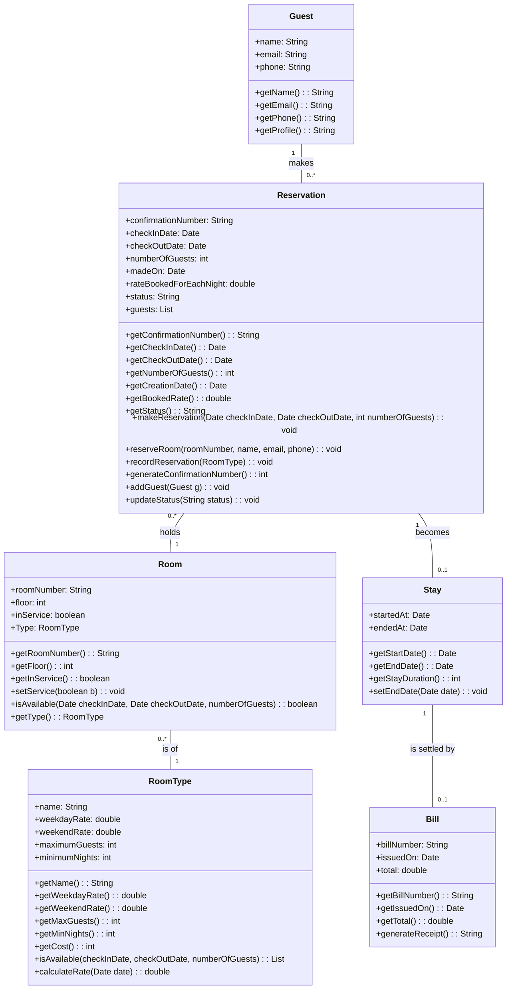
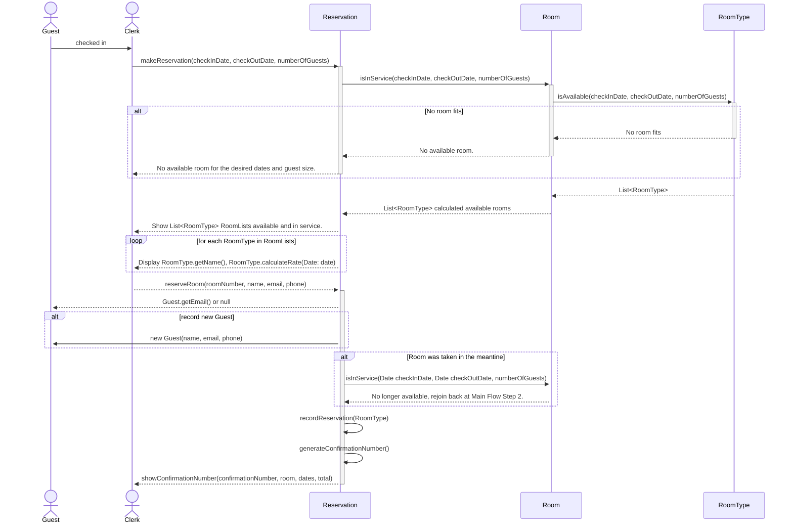
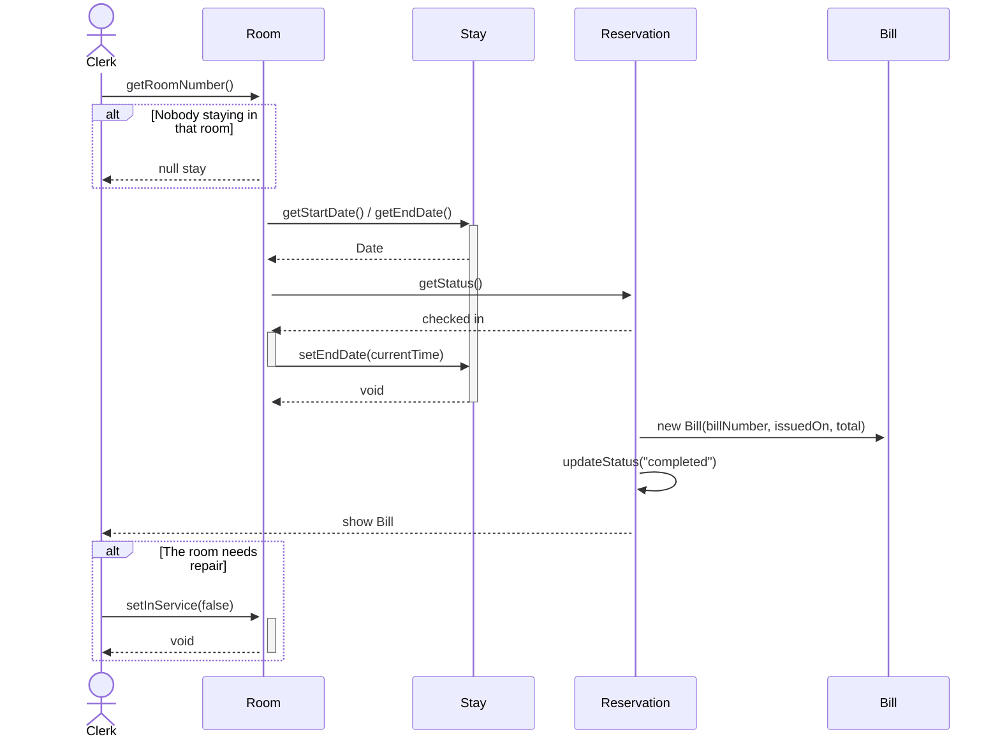

# Assignment 2: Na Cha

## Deliverable 1: Mapping Table

| Entity | Verdict | Becomes | If no class, where it went |
| - | - | - | - |
| Guest | one class | `Guest` | - |
| Room Type | one class | `RoomType` | - |
| Room | one class | `Room` | - |
| Reservation | one class | `Reservation` | - |
| Stay | one class | `Stay` | - |
| Bill | one class | `Bill` | - |

No entity was split into separate classes (or none) because they represent their own unique responsibilities. Such that one role one entity/class is fulfilled, and that there are no god object/entity that knows too much and is responsibile for too much.

## Deliverable 2: Class Model

### Class Diagram

### Responsibilities

- **Guest**: Responsible for: knowing who a guest is. Traces to: entity Guest.
- **RoomType**: Responsible for: knowing the hotel room categories. Traces to: entity Room Type.
- **Room**: Responsible for: knowing the physical room status. Traces to: entity Room.
- **Reservation**: Responsible for: knowing a guest's reserved dates for a room. Traces to: entity Reservation
- **Stay**: Responsible for: knowing guests' stay status. Traces to: entity Stay.
- **Bill**: Responsible for: knowing what the guest was charged. Traces to: entity Bill.

I used no hierarchy and no interface because the different types/categories of rooms differ only in their RoomType fields data, such as name, rates, guest sizes.

## Deliverable 3: Sequence Diagrams

### UC-1: Reserve a Room

### UC-4: Check Out

## Deliverable 4: Responsibility Table

| Job | Owner | Method | Data it needs, and the class that holds it |
| - | - | - | - |
| Find a guest by email, or record a new guest | `Guest` | `new Guest(name, email, phone)` | `name`, `email`, `phone` from `Guest` |
| Say whether a room is free for every night of a date range | `RoomType` | `isAvailable(checkInDate, checkOutDate, numberOfGuests)` | `checkInDate`, `checkOutDate`, `numberOfGuests` from `Reservation` or `Clerk` |
| Find every room that is in service, holds a given number of guests, allows a stay that long, and is free for a date range | `Room` | `isInService(Date checkInDate, Date checkOutDate, numberOfGuests)` | `checkInDate`, `checkOutDate`, `numberOfGuests` from `Reservation` or `Clerk` |
| Say what one night costs for a room type on a given date, at today’s rates | `RoomType` | `calculateRate(Date date)` | `date` from `Clerk` and rate from `RoomType` self |
| Say whether a stay is long enough for a room type | `Stay` | `getStayDuration()` | `startedAt` and `endedAt` from `Stay` self |
| Record the rate booked for each night of a new reservation | `Reservation` | `recordReservation(RoomType)` | `RoomType` object from `Reservation` self/passed parameter |
| Find a reservation by its confirmation number | `Reservation` | `getStatus()` | `confirmationNumber` from `getConfirmationNumber()` |
| Work out what a guest owes at check-out | `Reservation` | `getBookedRate()` | `rateBookedForEachNight` from `Reservation` self for `Bill` |

## Deliverable 7: Reflection

I moved the majority of my logic of calculating price from Room to RoomType. If it stayed in Room, it would've not been an issue, but rather an annoyance of consistenting bugging two classes for single values. Like price calculation for example. I had it estimate a cost during the checking phase of `isAvailable()` in RoomType. I also added more methods than I had originally wanted to, to the point where I think refactoring will be a big issue down the line should we reuse this code segment for future projects. But perhaps I could've also done it differently with more logic into Reservation, rather than the Room Type.

I'm not sure if I made it clear already but, I am still unsure about the necessarily responsibilities each classes should have. When working on this project, I realized that I iterated a lot more on-the-go and sometimes forgot to add or note the changes I've made to my classes, and the design diagram as well. Not to mention, the spagehtti designs that I made that only hurts the process of implementation. UC-1's Alt flow was the one I pondered on the most, since I had to digest it to a certain point and not rush through it for my code.